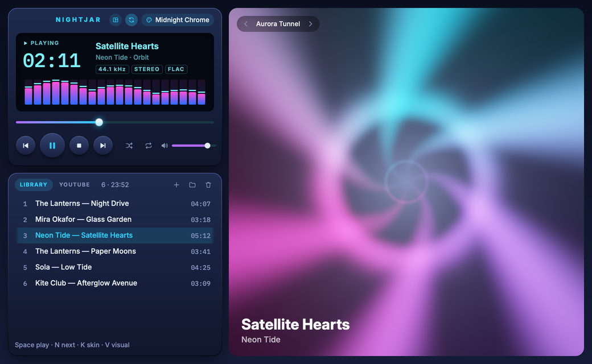
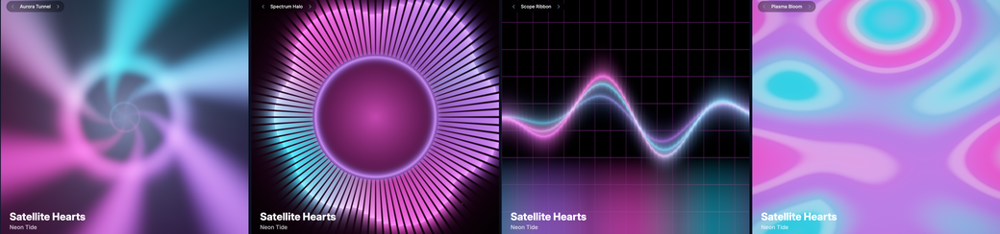
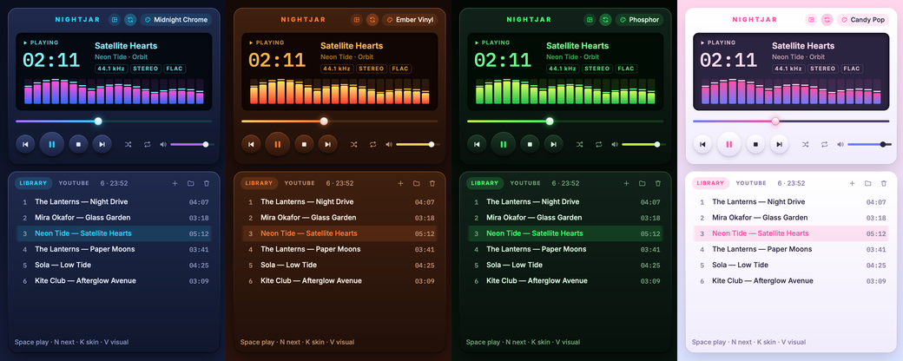
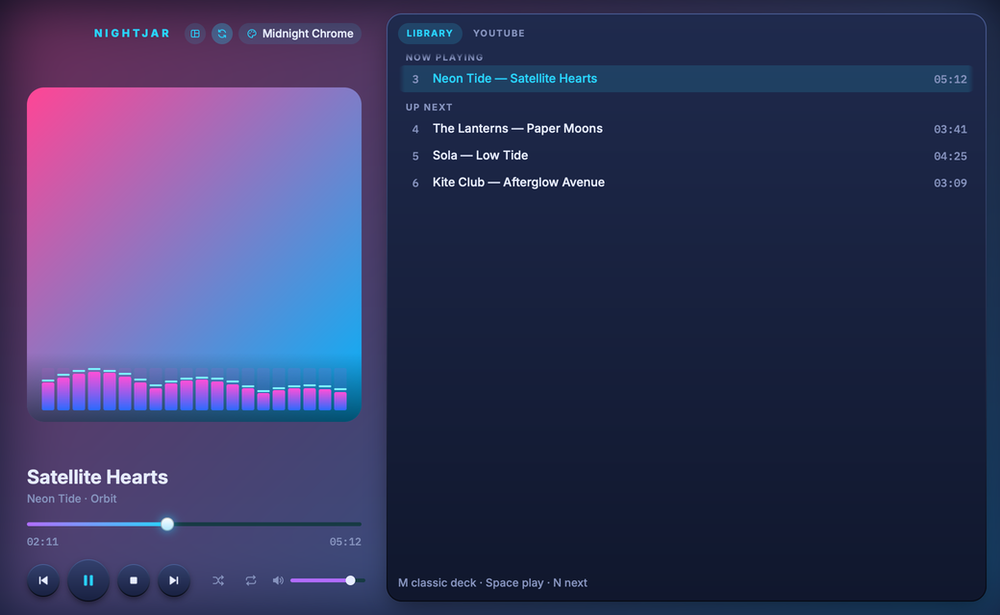

# Nightjar

A skinnable music player for macOS with live, music-driven visualizers, built with
[Rune](https://github.com/anomalyco/rune) (GPU-rendered native UI in Rust). It plays your own
files, and YouTube Music through a built-in YouTube Music window.



| Four shader visualizers | Four skins (they can cycle every 7 seconds) |
|---|---|
|  |  |



## Requirements

- macOS 14.2 or later on Apple silicon (the YouTube spectrum uses Core Audio process taps).
- Rust 1.88 or later (edition 2024, let chains) and the Xcode Command Line Tools
  (`xcode-select --install`) for `swiftc`.

## Build and run

```sh
cargo run --release -- ~/Music/some-album     # files or folders; the first plays
scripts/install.sh                             # builds and installs ~/Applications/Nightjar.app
```

`scripts/install.sh` uses the bundle ID `dev.mustafa.nightjar`; set `NIGHTJAR_BUNDLE_ID` to
use your own, and `MAC_APP_SIGN="<signing identity>"` to sign with a certificate (macOS then
remembers the audio permission across rebuilds).

## Window

- **Deck**: a display with play state, a clock (click it for remaining time), title,
  artist · album, rate / channels / codec tags, and a 20-band spectrum with falling peak caps.
  Below it are the seek bar (drag to scrub), the transport buttons, shuffle, repeat
  (off → playlist → track) and volume. Shuffle fixes a shuffled order when it's turned on, so
  up next is always what plays. Drag any bare surface (the gaps, the card faces or the
  visualizer) to move the window.
- **Playlist**: drop files or folders anywhere in the window, or use `+` (file) and the folder
  button. Click a row to select it; double-click or `↵` plays it. `⌫` removes the selected row,
  and the bin clears the list. The playlist, skin, mode, volume, shuffle and repeat are kept in
  `~/.config/nightjar/settings.json` (`NIGHTJAR_CONFIG` overrides the path).
- **Stage**: a full-height visualizer with four modes: Aurora Tunnel, Spectrum Halo, Scope
  Ribbon and Plasma Bloom. Bass, mids, treble, beats, a 64-bin spectrum and the waveform drive
  it. Its clock runs faster when the music is louder, and it stops when playback stops.
- **Skins**: Midnight Chrome, Ember Vinyl, Phosphor and Candy Pop. Each skin sets the colours of
  every surface and the visualizer palette, and switching skins fades every colour on a spring.

- **Modern layout** (the layout button in the header, or `M`): large album art with the live
  spectrum along its bottom edge, the title, a seek bar with times, and the transport; beside
  it, **Now playing** and **Up next** from the playlist (repeat-aware; with shuffle on it says
  the shuffled order with shuffle on). Behind it all, the cover is blurred across the window
  (`NIGHTJAR_BACKDROP=0` turns that off). On YouTube, the right side shows YouTube Music's own
  queue. Art comes from the cover embedded in the file's tags, else a
  `cover`/`folder`/`front` image in its folder, or YouTube's artwork. The layout has no shader
  stage, so it's the lighter of the two.

- **Skin cycle**: every 7 seconds the skin fades to the next one, in a loop. The loop button
  in the header turns it off (and on); a skin picked by hand stays its full 7 seconds.

Formats: mp3, flac, wav, m4a/aac, ogg/vorbis.

## YouTube Music

> Nightjar's YouTube Music window is an unofficial client. It isn't affiliated with, endorsed
> by or connected to YouTube or Google. It loads music.youtube.com and plays it with YouTube's
> own web player; it doesn't download or extract streams.

The **Library | YouTube** tabs (or `Y`) switch Nightjar to YouTube Music. It plays in a
YouTube Music window that Nightjar opens itself: music.youtube.com in WebKit with YouTube's own
player, so you sign in, search and pick music there. Closing that window hides it, and the music
keeps playing.

- The deck shows the song's title, artist, time and seek bar, and the transport, seek and volume
  control it. The modern layout shows YouTube's queue, and a click on a song plays it.
- The spectrum and visualizer come from a Core Audio process tap on Nightjar's own WebKit
  processes (macOS 14.2+). The first capture asks for **System Audio Recording** permission.
  WebKit doesn't feed YouTube's streams into Web Audio, so a page-level analyser would only
  read silence.

It's one app: the Swift backend (`backend/`: the YouTube window, the page script, the audio tap)
is compiled into a static library by `build.rs` and linked into Nightjar. Rust calls it through
four C functions (`src/youtube.rs`). Rune draws everything else.

`scripts/install.sh` builds the app bundle itself, so its `Info.plist` carries the audio usage
string. Ad-hoc signing makes macOS ask for the permission again after each install;
`MAC_APP_SIGN="<identity>"` keeps the answer.

`cargo run --release --example youtube_check` checks the YouTube side without a window or sound:
a silent player (throwaway session, muted media, no tap) loads a song, waits for the queue and
plays its third song.

## Notch link (optional companion)

Nightjar publishes what it plays over UDP on `127.0.0.1`, so a companion app (a notch widget, a
menu bar item, a stream overlay) can show and control it. Nothing listening is fine: the
packets are dropped.

- Status, JSON, to port 47811: `state` (playing, paused, stopped), `title`, `artist`, `pos`,
  `dur`, `bands` (20 spectrum levels, 0 to 1), and the skin's `accent`, `accent2` and `bars`
  colours. 30 times a second while playing, once a second otherwise.
- Commands, plain text, to port 47812: `toggle`, `next` or `prev`.

[NotchSwitcher](https://github.com/mustafa89/macos-notch-app) uses it for a now-playing panel and a
Live Activity in the MacBook notch.

## How it works

| File | Role |
|---|---|
| `src/audio.rs` | rodio playback. A `Tap` source mixes every decoded frame to mono and copies it into a lock-free ring (`Scope`). The audio device opens on the first play. |
| `src/analysis.rs` | A 2048-point Hann-windowed FFT (rustfft) on the main thread, about 60 times a second: deck bands, peaks, 64 bins, a 64-point waveform, bass/mid/treble and a beat pulse. |
| `src/state.rs` | Playlist and transport actions. `poll` reads tags, moves to the next track at the end, and publishes levels into `rune::Live` values, so the bars, seek bar and clock move without re-running the view. |
| `src/viz.rs` | A Rune `Compositor`. It draws the UI with `Renderer::draw_with` and paints one WGSL shader into the stage's `El::effect` slot. A uniform buffer feeds the shader the levels and the skin palette. |
| `src/bridge.rs` | The notch link: status out, commands in. |
| `src/youtube.rs` | The YouTube Music source: the C calls into the Swift backend. |
| `backend/*.swift`, `build.rs` | The YouTube window, its page script and the audio tap, built into a static library. |
| `src/art.rs` | Album art: embedded covers, cover files and YouTube artwork, fetched on a worker and decoded by Rune's image cache. |
| `src/library.rs` | Folder scans, plus tags and durations read by symphonia on a background thread. |
| `src/skin.rs`, `src/view.rs`, `src/icons.rs` | Skins, layout and icons. |

## Keys

| Key | Action |
|---|---|
| `space` | play / pause |
| `←` `→` | seek 5 s |
| `⇧←` `⇧→` / `p` `n` | previous / next track |
| `↑` `↓` | volume |
| `⇧↑` `⇧↓` / `j` | move the selection |
| `↵` | play the selected track |
| `s` | stop |
| `h` | shuffle |
| `r` | repeat: off → playlist → track |
| `k` / `K` | next / previous skin |
| `v` / `V` | next / previous visualizer |
| `y` | switch source: library ↔ YouTube Music |
| `m` | switch layout: classic deck ↔ modern |
| `⌫` | remove the selected track |
| `q` | quit |

## Checks

```sh
cargo test --release                       # analyser and headless UI tests
cargo test --release -- --ignored          # real playback through the output device, at volume 0
target/release/nightjar --snap out/deck.png --scene deck        # also: empty, skin1-3, viz1-3, youtube, modern, modern-noart
```

Snapshot scenes use sample tracks and made-up levels. They need no music files and no audio
device.
